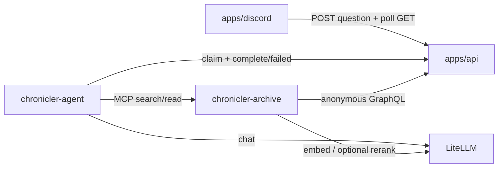

# Agent architecture (`apps/agent`)

**App:** `apps/agent`  
**Implements:** [agent-qa-http](/docs/interfaces/agent-qa-http.md)

## Verdict

`apps/agent` is the Python deployable for **answering** grounded questions and (when ported) **indexing** the public Archive. The Go API owns job durability. Discord only submits and polls. There is **no RabbitMQ** on the monorepo path.

## Components

| Component           | Package / binary                  | Role                                              |
| ------------------- | --------------------------------- | ------------------------------------------------- |
| Answer harness      | `pi.chronicler.agent`             | Admit question, research loop, validate citations |
| Worker process      | `chronicler-agent`                | Claim jobs from API, run harness, POST result     |
| Archive MCP         | `pi.chronicler.archive` (Phase C) | Index public docs; serve search/read tools        |
| Shared QA contracts | `pi.chronicler.qa` (Phase C)      | Public document eligibility, chunking helpers     |
| Inference gateway   | LiteLLM (external)                | Chat + embeddings                                 |
| Job store           | `apps/api` `internal/agent`       | Persist queued / terminal question rows           |

## Trust boundaries

- **Ingest secret** (`X-Ingest-Secret`) gates Discord and worker calls to agent HTTP routes. Not a member JWT.
- **Archive MCP token** gates tool calls from the worker to Archive. Archive must not accept unauthenticated MCP.
- **Anonymous GraphQL** is the only live corpus path for Archive sync. No DB credentials for the answering worker.
- **Model tools** are Archive search/read only. No web, shell, or filesystem tools.

## Data flow

## Failure modes

| Outcome                                                          | Worker publishes                             | Discord sees   |
| ---------------------------------------------------------------- | -------------------------------------------- | -------------- |
| Supported / unsupported / routed answer                          | `question.completed` with answer + sources   | Rendered reply |
| Archive or model timeout/error; validation or context exhaustion | `question.failed` with stable user message   | Failure reply  |
| Invalid job payload                                              | Reject / leave unclaimed per claim semantics | N/A            |

**Diagnostics** (trace, admission category, timings) may be stored on the result JSON for operators. Discord `parseQuestionResult` does not require diagnostics today.

## Packages on disk

| Path                         | Status                                      |
| ---------------------------- | ------------------------------------------- |
| `src/pi/chronicler/agent/`   | Harness + HTTP claim/complete worker        |
| `src/pi/chronicler/archive/` | MCP server + LanceDB indexer                |
| `src/pi/chronicler/qa/`      | Contracts, chunking, GraphQL source helpers |

## Related

- [http-transport.md](/apps/agent/docs/http-transport.md)
- [archive.md](/apps/agent/docs/archive.md)
- [environment.md](/apps/agent/docs/environment.md)
- [legacy-mapping.md](/apps/agent/docs/legacy-mapping.md)
- [port-gap-audit.md](/apps/agent/docs/port-gap-audit.md)
