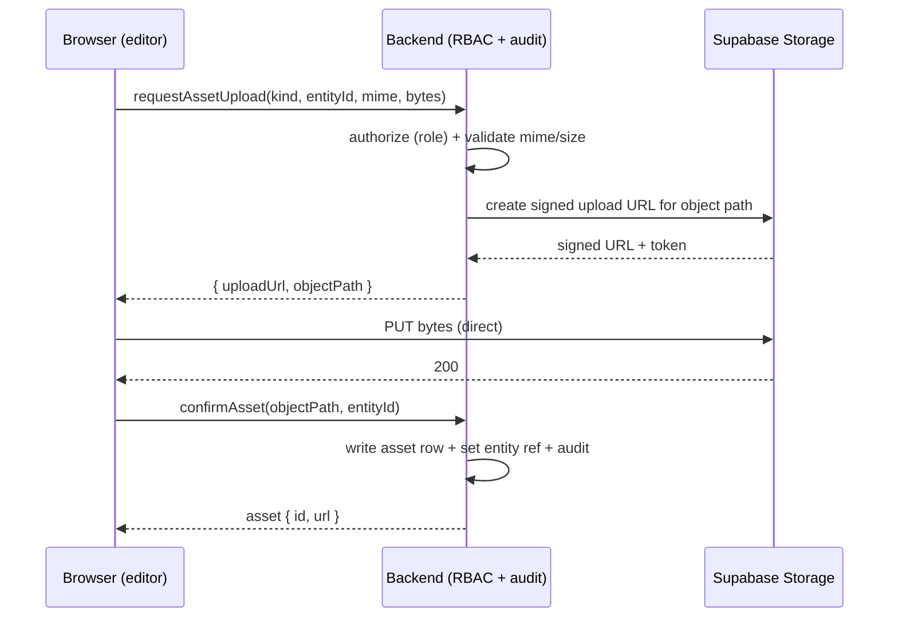

As-built living note. Scrubbed from quarry; prefer durable symbol/schema names over path:line.
Interfaces: see [docs/interfaces/](/docs/interfaces/README.md).

# Object Storage & Multimedia Design

How Chronicler should store and serve binary media (map images, guild seals,
avatars, quest battle-maps, and future character portraits) once the app owns its
own assets instead of borrowing Discord's CDN.

This is a **design doc written before schema v2 lands**, so the new schema can
reserve the right shape for asset references and nothing downstream has to be
reworked later. No code is proposed for now — see [Rollout](#rollout).

Related: [Domain-Model-and-Decisions](/docs/interfaces/media-linked.md),
[map-authoring-workspace-design.md](/apps/web/docs/map-authoring.md).

## Answers up front

Three questions were asked. The short answers:

| Question | Answer |
| --- | --- |
| Do we have object storage on Supabase already? | **Provisioned but unused.** The `storage` schema exists (8 system tables), but there are **0 buckets** and **0 objects**. Nothing is stored. |
| If we have multimedia, how do we store/retrieve it? | **There is no mechanism today.** Every image field is a nullable `*_url` text column pointing at an *external* URL (Discord CDN or hand-entered). The only upload UI (`WorldHexGrid` base image, quest battle-map) reads the file into an in-memory `data:` URL that is never persisted or sent to the backend. |
| Do we have documentation for it? | **No.** This document is the first. |

## Current state

### What actually exists

Evidence from the live tree (2026-07-12):

| Surface | Field / element | Reality |
| --- | --- | --- |
| `AtlasModel` (`db/models/world.py`) | `image_url: Text` | External URL string. No upload path. |
| `GuildProfileModel` (`db/models/world.py`) | `seal_image_url: Text` | External URL string. |
| ~~`HomeContentBlockModel`~~ (deleted, backend hygiene batch 2 -- zero Python callers; table `home_content_blocks` untouched) | `image_url: Text` | External URL string (marketing tiles). |
| `PersonModel` (`db/models/identity.py`) | `discord_avatar_hash`, `discord_banner_hash` | Discord CDN hashes; resolved to `avatarUrl`/`bannerUrl` in `MeType`/`PartyMemberType`. Not owned by us. |
| Frontend `WorldHexGrid.tsx` | `<input type="file">` → `handleImageUpload` | `FileReader.readAsDataURL` → in-memory `data:` URL. Lost on reload. **Never reaches the backend.** |
| Frontend `QuestSummaryPage.tsx` | battle-map panel | Placeholder: "not yet uploaded (no upload backend)". |
| Dependencies | `@supabase/supabase-js`, `storage3`, `boto3`, any S3 SDK | **None present** in backend, frontend, or bot. |

### Why this is a problem now

The [website-first pivot](/README.md) removes the Discord CDN crutch:
editors now author on the website, so there is no Discord message to host the
image. The map authoring workspace design already assumes editors can bring a
base map image; its "attach documents" flow is **record-linking**
(`map_document_links` → quests/chronicles/artifacts), **not** binary upload — so
that design does not close this gap either. Binary asset storage is unaddressed
everywhere.

## What Supabase Storage gives us

Supabase Storage is an S3-compatible object store fronted by a CDN, with the same
Postgres-row + RLS model the rest of the app already uses:

- **Buckets** — namespaces, each `public` or `private`.
- **`storage.objects`** — one row per object; RLS policies gate read/write exactly like our table RLS (already enabled on all 52 app tables).
- **Signed upload URLs** — short-lived, single-object write grants. The server mints them; the browser PUTs the bytes directly. Bytes never transit our API.
- **Signed download URLs** — time-boxed read grants for `private` buckets.
- **Public URLs + CDN** — for `public` buckets, a stable CDN URL with no signing.
- **Image transformations** — on-the-fly resize/format (thumbnails) via query params.

Crucially, the `postgres` role (our app's connection) **bypasses RLS**, so the
backend can mediate everything without a separate service key if we route through
it — see the upload flow below.

## Recommended architecture

### Principle: backend-mediated, fail-closed

The write model is RBAC'd and audited. Asset writes must inherit that, not open a
second unauthenticated door (the same failure #47 fixed for ingest). So:

- The **browser never gets the service key** and never writes to Storage with ambient credentials.
- The **backend authorizes** (same RBAC check as the entity write), then mints a **scoped, short-lived signed upload URL** for one object path.
- The browser PUTs bytes straight to Storage using that URL (keeps large files off our API/compute).
- The backend records the resulting object path against the entity **and** writes an audit row, same as any other mutation.



### Bucket layout

Group by lifecycle and visibility, not by entity, so policies stay few:

| Bucket | Visibility | Holds |
| --- | --- | --- |
| `public-media` | public | Anything meant to be world-readable: guild seals, atlas/map base images, home content tiles, published character portraits. Served via CDN URL. |
| `user-avatars` | public | User-uploaded avatars/banners (custom, independent of Discord). |
| `private-drafts` | private | Unpublished/draft assets, quest battle-maps gated to participants. Served via signed download URL. |

Start with `public-media` only; add the others when a private surface actually needs them.

### Object path convention

Deterministic, collision-free, and portable:

```
<entity-type>/<entity-id>/<asset-id>.<ext>
# e.g. guild/9b1c…/2f7a….webp
#      atlas/A-1/8c04….png
```

Store the **object path**, never a fully-qualified URL, on the entity/asset row.
The host (`https://<ref>.supabase.co/storage/v1/...`) is environment-specific;
baking it into the DB breaks the moment the project ref or CDN domain changes.
Resolve path → URL at read time.

### Retrieval

- `public-*` buckets: backend resolves `objectPath` → CDN URL (optionally with a transform for thumbnails). No signing.
- `private-*` buckets: backend mints a signed download URL per request, gated by the same read RBAC as the entity.

## Schema implications (reserve this before v2 lands)

> **Schema v2 outcome (resolved):** v2 §7 locked an `assets` table **plus a polymorphic `asset_links(target_type, target_id)` join table** (decision 28) — *not* the per-entity `*_asset_id` FK columns (`seal_asset_id`, `battle_map_asset_id`, `portrait_asset_id`) recommended below. Assets attach to any target through `asset_links`, so there are no per-entity FK columns to add. Read Option A / the entity table below as the *design input* that fed this decision, not the final shape. The Supabase Storage mechanics (buckets, signed URLs, path convention, rollout) still hold. See [Domain-Model-and-Decisions](/docs/interfaces/media-linked.md).

This is the point of writing now. Two viable shapes:

**Option A — dedicated `assets` table (recommended).** One row per stored object,
referenced by entities via FK. Handles many-assets-per-entity (galleries), carries
provenance/audit, and decouples the media lifecycle from the entity.

```text
assets
  id            uuid pk
  bucket        text not null          -- 'public-media' | ...
  object_path   text not null unique   -- 'guild/<id>/<asset>.webp'
  mime_type     text not null
  byte_size     bigint not null
  width, height int null               -- for images
  uploaded_by   text not null          -- discord_id (audit)
  created_at    timestamptz not null
  -- optional soft target for polymorphic use:
  entity_type   text null
  entity_id     text null
```

Entities keep a nullable FK (e.g. `guild_profiles.seal_asset_id`) instead of a
raw URL.

**Option B — keep `*_url` columns, store object path.** Least churn: repoint the
existing `image_url` / `seal_image_url` columns at an internal object path rather
than an external URL, and resolve to a URL at read time. Cheaper now, but no
gallery support, no per-asset audit, and it overloads a column that historically
meant "external link."

**Recommendation:** v2 should reserve the `assets` table (Option A) and migrate
the existing `*_url` fields to `*_asset_id` FKs. Keep the GraphQL `*Url` fields —
resolvers compute them from the path — so the frontend contract is unchanged.

### Entities to account for

v2 attaches all of these via `asset_links(target_type, target_id)` rather than per-entity FK columns (see the outcome note above). v2 nouns shown:

| Target (v2) | Today | v2 attachment |
| --- | --- | --- |
| `maps` base image | `image_url` | `asset_links` row, `target_type='map'` (from the `WorldHexGrid` upload stub) |
| Guild codex entry (`documents`, category=guild) | `seal_image_url` | `asset_links` row, `target_type='document'` — no typed guilds table (decision 47) |
| Home content tile | `image_url` | `asset_links` row (public bucket) |
| `members` avatar/banner | Discord hash | keep hash; optional `asset_links` row for custom uploads |
| `quests` battle-map | none (stub) | `asset_links` row, `target_type='quest'` (private bucket) |
| `characters` portrait | **no field exists** | `asset_links` row, `target_type='character'` |

## Downstream risks if ignored

- The map-authoring upload UI ships and silently drops every image on reload (already true today).
- Schema v2 locks in raw `*_url` columns, and a later assets migration means backfilling + touching every image-bearing entity.
- Ad-hoc "just paste an external URL" persists — mixed-content, dead links, and no control over what's embedded.

## Rollout

Post-schema, in order. Nothing here is built now.

1. Provision `public-media` bucket + RLS (read: public; write: `postgres`/service only).
2. Add the `assets` table + `*_asset_id` FKs in the v2 migration.
3. Backend: `requestAssetUpload` (signed URL, RBAC + validate) and `confirmAsset` (record + audit) mutations.
4. Frontend: replace the `data:` URL stubs in `WorldHexGrid` / quest battle-map with the two-step upload flow.
5. Add `private-drafts` + signed downloads only when a gated surface needs it.

## Open decisions

- **Public vs private default** — seals/maps are world-readable (public + CDN); battle-maps may be participant-only (private + signed). Confirm per surface.
- **Image processing** — rely on Supabase transform params for thumbnails, or pre-generate on upload? Transform-on-read is simplest to start.
- **Size/type limits** — set `file_size_limit` and `allowed_mime_types` per bucket at creation. Propose ≤5 MB, `image/png|jpeg|webp` for `public-media`.
- **Orphan cleanup** — a confirmed-but-unreferenced asset needs a sweep; decide GC policy when the assets table lands.
