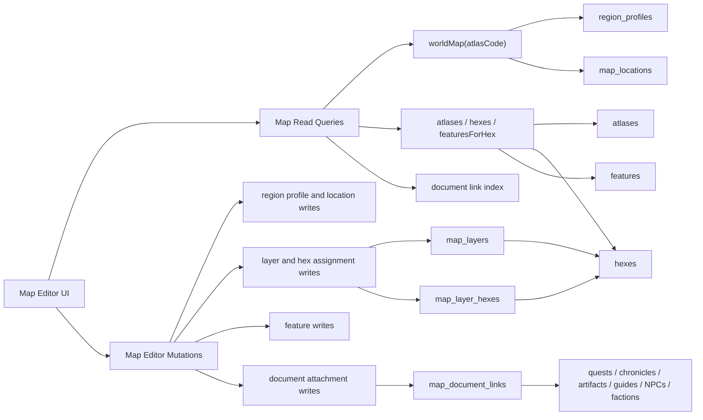
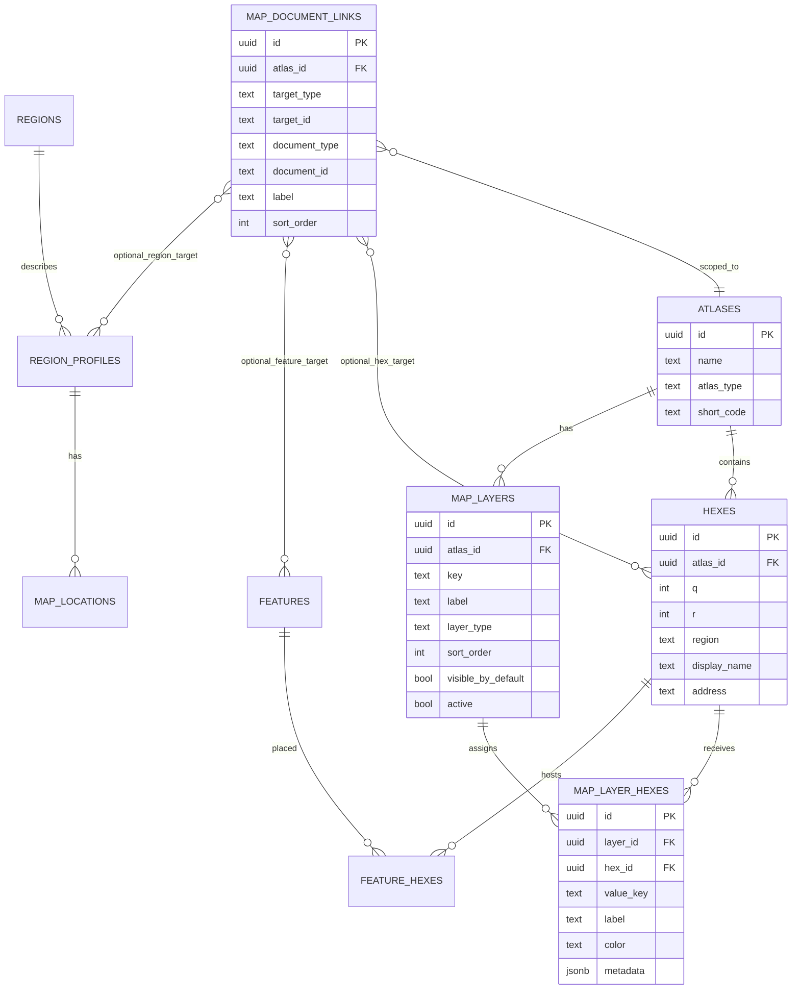
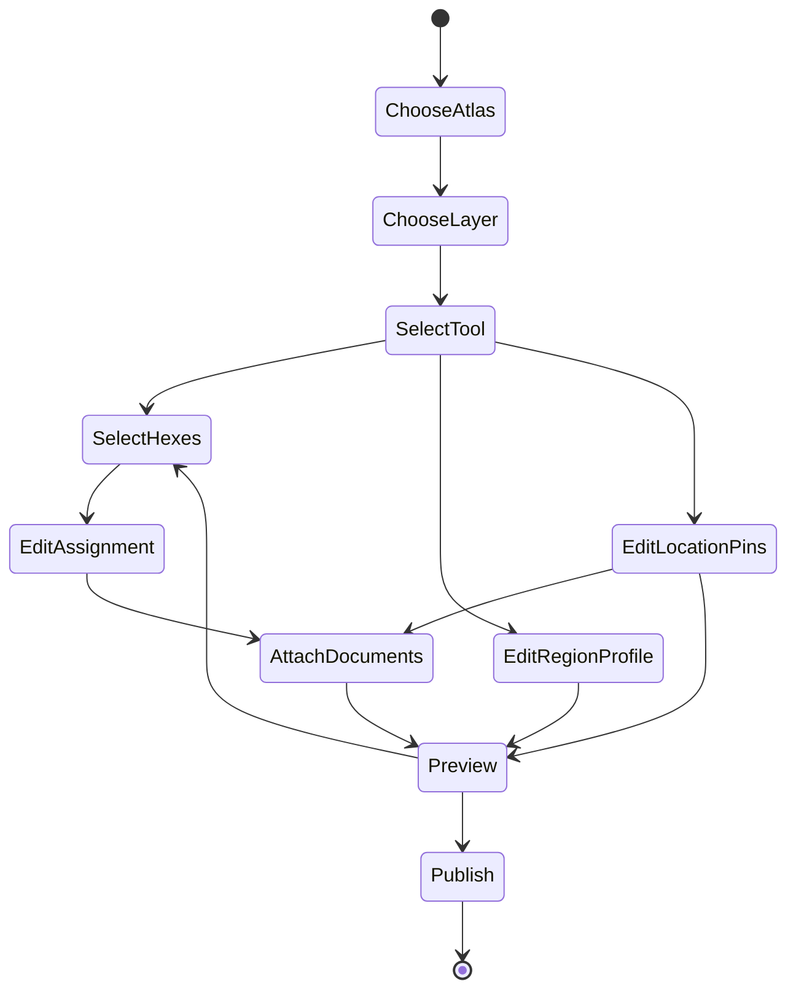
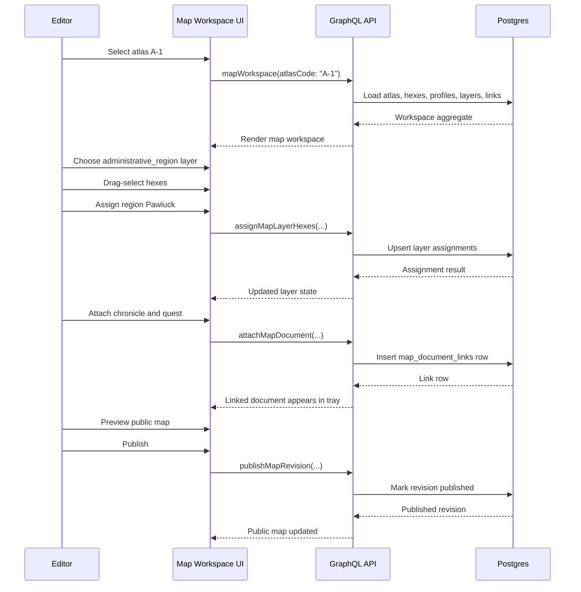

# Map activation and authoring guidance

This page owns the dormant web map’s activation gate and retains the earlier authoring proposal as explicitly unapproved exploration.

Standalone interaction prototype and adversarial design review were removed from the repo (optional local copy under `.local/docs-quarry/archive/`).

## Current state and deferred activation

**Activation remains deferred.** The authoritative route registry is `features/map/feature.ts`: both `/map` and `/map/:atlasCode` render `MapComingSoonPage`; region hubs remain available separately. This consolidation neither activates routes nor authorizes data creation/import.

The rebuild has an unwired `MapPage` → `useMapPage` → Zod adapter path and Go `spatial.Queries.MapView`/GraphQL reads. It is not the legacy DRK viewport/package implementation: the current hook uses a client exploration mock, defaults to one atlas, and the `MapView` resolver emits empty `hexcode` values for places. Restore and verify the accepted read-only surface and eligible package registry before assuming a route-only activation is ready. These are source observations, not production-data or performance measurements.

### Resume and launch checklist

The September 13 closeout accepted the following gate. Its then-empty anonymous production map result explains historical dormancy; current production eligibility remains unverified.

1. Confirm an eligible canonical production hexgrid map intersects the build-time package registry. Creating/importing data requires separate owner authorization; fixture fallback must not disguise absent canonical data.
2. Repeat a read-only eligibility preflight and verify permission-safe `mapView` projection using the existing [live authority](/docs/interfaces/live-authority.md) and [document scope](/docs/interfaces/scoped-body.md). Names, linked-document metadata, enumeration counts and selection state must not disclose hidden places. No second map fog/discovery authority is introduced.
3. Verify anonymous/member/DM hidden-selection cases, viewer-transition cache clearing, canonical `/codex/location/:slug` navigation, theme switching, compressed responses, keyboard/focus behavior, accessible directory/selection announcements, and the named browser interaction/accessibility checks. Verify exact current route/contract/package support before execution; historical merge tests are not current proof.
4. Retain cold-cache timings and capture conditions. Historical admission required at least 20 cold-cache desktop and constrained-mobile profiles, first-usable p75 <1s and selection p95 ≤100ms; failure blocked launch. Current migration comparison is **1920×1080 only**, which supersedes the old mobile comparison scope but supplies no new mobile performance evidence or changed threshold approval. Revalidate the performance protocol/remaining profile obligation with the owner before activation.
5. After these prerequisites pass, make activation a separate small route-wiring change replacing the two Coming Soon routes. Retain a route-only rollback that restores Coming Soon while preserving canonical persistence, audience corrections, projections and inert assets/components. Execute any production promotion/rollback through the accepted Actions release process, with separate authorization.

Advertising/navigation promotion, authoring, quest markers, city/pointcrawl extensions, and removal of the old spike remain separate decisions. The launch gate does not accept the proposed authoring schema or permissions below.

## Historical authoring proposal

The remainder is retained design exploration, **not the current Go wire/storage model or an accepted implementation plan**. Names such as `worldMap`, `region_profiles`, layers, Python signatures and the A-1 walkthrough describe an older proposal; do not recreate them during migration without a reviewed decision. Implement any approved future surface through the accepted [web architecture](/apps/web/docs/architecture.md): PageHost/PageDeclaration, a composition hook, query/mutation hooks and Zod edge adapters, with props-only feature components.

## Recommended Direction

Adopt a layered authoring model on top of canonical atlases and hexes.

The core rule:

> `hexes` represent physical cells. Layers describe what those cells mean in a specific editorial context.

This avoids overloading `hexes.region` with every future use case. Administrative region, faction control, danger state, visibility, terrain, and quest activity are different meanings and should not all compete for the same column.

## Conceptual Architecture



## Proposed Data Model



## Layer Types

Initial layer vocabulary should be small and explicit.

| Layer key               | Purpose                                   | Edited by                    | Notes                                        |
| ----------------------- | ----------------------------------------- | ---------------------------- | -------------------------------------------- |
| `administrative_region` | Which canonical region owns a hex         | Admin, director              | May sync to `hexes.region` for compatibility |
| `terrain`               | Terrain and traversal flavor              | Admin, cartographer          | Can later generate features                  |
| `faction_control`       | Who controls or contests a hex            | Director, DM with permission | Do not put this in `hexes.region`            |
| `threat_state`          | Siege, corruption, danger, blocked access | Director, DM with permission | Can link to world events                     |
| `visibility`            | Public, discovered, DM-only               | Admin, director              | Controls player-facing rendering             |
| `quest_activity`        | Live/open/scheduled quest pins            | Derived                      | Should not be manually painted               |

## Proposed GraphQL Surface

### Read Queries

```python
def map_workspace(atlas_code: str = "A-1") -> MapWorkspaceType:
    """TODO: Return atlas, hexes, layers, profile data, pins, links, and permissions."""
```

```python
def map_document_candidates(
    search: str,
    document_types: list[str] | None = None,
    limit: int = 20,
) -> list[MapDocumentCandidateType]:
    """TODO: Search quests, chronicles, artifacts, guides, NPCs, factions, and regions for linking."""
```

```python
def map_change_log(
    atlas_code: str = "A-1",
    limit: int = 50,
) -> list[MapChangeLogEntryType]:
    """TODO: Return recent map authoring changes for review and rollback context."""
```

### Mutations

```python
def upsert_region_profile(input: RegionProfileInput) -> RegionProfileType:
    """TODO: Create or update map-facing editorial profile for a canonical region."""
```

```python
def upsert_map_location(input: MapLocationInput) -> MapLocationType:
    """TODO: Create or update a named visual location pin on the atlas."""
```

```python
def delete_map_location(id: UUID) -> bool:
    """TODO: Remove a visual location pin after permission check."""
```

```python
def upsert_map_layer(input: MapLayerInput) -> MapLayerType:
    """TODO: Create or update an editable layer for an atlas."""
```

```python
def assign_map_layer_hexes(input: AssignMapLayerHexesInput) -> MapLayerAssignmentResultType:
    """TODO: Bulk assign selected hexes to a layer value, such as region=Pawluck."""
```

```python
def clear_map_layer_hexes(input: ClearMapLayerHexesInput) -> MapLayerAssignmentResultType:
    """TODO: Remove selected hexes from one layer without deleting the hexes themselves."""
```

```python
def attach_map_document(input: AttachMapDocumentInput) -> MapDocumentLinkType:
    """TODO: Attach an existing content record to an atlas, region, hex, feature, or location."""
```

```python
def detach_map_document(id: UUID) -> bool:
    """TODO: Remove a document link without deleting the source document."""
```

```python
def publish_map_revision(input: PublishMapRevisionInput) -> MapRevisionType:
    """TODO: Promote draft map changes into the player-facing published view."""
```

## Editor Interaction Model



The editor should have four working zones.

1. Left rail: atlas, layer, and tool selection.
2. Center canvas: selectable hex map with layer overlays.
3. Right inspector: selected region, hex, feature, or pin details.
4. Bottom tray: linked documents, change summary, and draft/publish controls.

## Authoring Process



## Permissions

Use role-gated write surfaces rather than the existing operator-batch-only mutation shape.

Recommended permissions:

| Action                       | Admin | Director      | DM                   | Player |
| ---------------------------- | ----- | ------------- | -------------------- | ------ |
| View public map              | yes   | yes           | yes                  | yes    |
| View DM-only layers          | yes   | yes           | scoped               | no     |
| Edit region profile          | yes   | scoped region | no                   | no     |
| Assign administrative region | yes   | scoped region | no                   | no     |
| Edit faction/threat layers   | yes   | scoped region | scoped grant         | no     |
| Attach documents             | yes   | scoped region | own/scoped documents | no     |
| Publish map revision         | yes   | scoped region | no                   | no     |

## Draft And Publish

Do not make every edit immediately player-facing.

Recommended model:

```text
map_revisions
  id
  atlas_id
  status: draft | published | archived
  created_by
  published_by
  created_at
  published_at

map_layer_hexes.revision_id
map_document_links.revision_id
```

If revisioning is too large for the first implementation, use an `is_published` flag and change log as an interim step. The API shape should still leave room for revisions.

## Implementation Phases

### Phase 1 - Make Existing Map Content Editable

Goal: close the current DB-backed/no-write-surface gap.

Deliver:

- `upsertRegionProfile`
- `upsertMapLocation`
- `deleteMapLocation`
- editor form for region profile fields
- editor form for location pins

No new layer model yet.

### Phase 2 - Render Hexes From DB

Goal: stop treating frontend `HEX_TILES` as the ownership source.

Deliver:

- `mapWorkspace(atlasCode)`
- atlas lookup by short code
- DB hexes rendered in `WorldHexGrid`
- compatibility adapter from `HexType[]` to current visual grid props

### Phase 3 - Add Layer Assignments

Goal: support painting regions and overlays per layer.

Deliver:

- `map_layers`
- `map_layer_hexes`
- layer selector
- click, shift-click, and drag-select hex editing
- bulk assignment mutation

### Phase 4 - Attach Documents

Goal: connect map entities to campaign knowledge.

Deliver:

- `map_document_links`
- document candidate search
- attachment tray
- links from hex/region/pin to quests, chronicles, artifacts, NPCs, factions, and guides

### Phase 5 - Draft, Preview, Publish

Goal: make map editing safe.

Deliver:

- draft workspace state
- public preview toggle
- publish mutation
- change log
- rollback target for admin users

## Frontend Component Shape

```text
features/map-editor/
  pages/
    MapEditorPage.tsx
  components/
    MapEditorShell.tsx
    MapLayerRail.tsx
    EditableHexCanvas.tsx
    HexSelectionToolbar.tsx
    MapInspectorPanel.tsx
    DocumentAttachmentTray.tsx
    PublishReviewPanel.tsx
  hooks/
    useMapWorkspace.ts
    useMapSelection.ts
    useAssignMapLayerHexes.ts
    useAttachMapDocument.ts
  adapters/
    mapWorkspaceAdapter.ts
```

## Acceptance Criteria

The first useful release of this feature is complete when:

1. An authorized editor can open the map editor for atlas `A-1`.
2. The editor can edit region profile fields without touching seed files.
3. The editor can create and move location pins.
4. The editor can select one or more hexes.
5. The editor can assign a region value to selected hexes on the administrative layer.
6. The editor can attach an existing document to a selected region, hex, or pin.
7. The public `/map` view reads only published data.
8. Player-facing rendering remains visually equivalent unless the editor publishes a change.

## Open Decisions

1. Should directors be allowed to publish their own region changes, or should admin approval be required?
2. Should `administrative_region` layer assignments sync back to `hexes.region`, or should `hexes.region` become legacy compatibility only?
3. Should map document links support external URLs immediately, or only first-class DB entities?
4. Should draft/publish ship in the first editor release, or should phase 1 use direct writes with an audit log?
