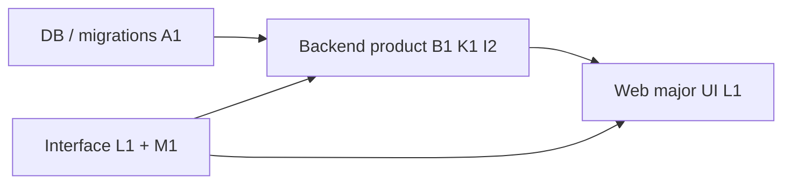

# Hobby cutover — locked owner decisions

**Status:** locked as of 2026-10-18 (user decisions in chat)  
**Audience:** Owner, implementers  
**Supersedes:** open questions in [hobby-db-simplification-memo.md](hobby-db-simplification-memo.md) § Owner decisions and [bulk-crud-performance-memo.md](bulk-crud-performance-memo.md) § Owner decision (defaults there are research-only).

**Scope:** Postgres squash, product GraphQL cutover, contracts/interface, web adoption, and backend completion gates for the hobby simplification thread.

---

## Decisions (A–M)

| ID  | Topic               | Choice | Summary                                                                                   |
| --- | ------------------- | ------ | ----------------------------------------------------------------------------------------- |
| A   | Migration history   | A1     | Squash to single `0001_init.sql`; disposable dev DBs OK                                   |
| B   | Authoritative stack | B1     | Product GraphQL + product SQL only; legacy discarded (site down, 0 users)                 |
| C   | Map model           | C3     | Pointcrawl-only; no hex-based maps in squashed schema                                     |
| D   | Notifications       | D1     | Inbox `notifications` only; no event ledger                                               |
| E   | Quest XP            | E1     | `character_progression_ledger` only                                                       |
| F   | Social/DM           | F1     | Minimal members + optional `dm_profiles`                                                  |
| G   | DDB                 | G2     | `character_ddb_mirrors.payload` JSONB in Postgres (1:1 with character)                    |
| H   | Agent questions     | H1     | Separate `agent_questions` table                                                          |
| I   | Idempotency         | I2     | Product-grade CommandMeta + DB receipts                                                   |
| J   | Document revisions  | J1     | Keep `document_revisions` (history, publish workflow)                                     |
| K   | DataLoaders         | K1     | Mandatory request-scoped loaders + batch SQL on product resolvers; no legacy N+1 under B1 |
| L   | Web `@pi/contracts` | L1     | Adopt package types before major UI on new stack                                          |
| M   | GraphQL phase 2     | M1     | Domain SDL + `_roots.graphql` part of "interface done"                                    |

**Notes on divergence from audit memos:** [hobby-db-simplification-memo.md](hobby-db-simplification-memo.md) listed hex-only maps and minimal idempotency as hobby defaults; **C3** and **I2** lock the opposite product-grade choices above. **B1** + **K1** align with the convergence direction in [bulk-crud-performance-memo.md](bulk-crud-performance-memo.md).

**Refinements (2026-10-18 escalations):** **D1** stands with **N4** — amend [notifications](../interfaces/notifications.md) to inbox-only (no channel-delivery ledger). **F1** stands with **N3** — no `member_follows`, `dm_requests`, or `request_decisions`; amend notifications/SDL for `DM_REQUEST_DECIDED` accordingly.

---

## Cutover escalations (N1–N9)

Locked in chat after cutover plan audit (local copy: `.artifacts/plans/cutover/AUDIT.md`, gitignored).

| ID  | Topic                | Choice | Summary                                                                                 |
| --- | -------------------- | ------ | --------------------------------------------------------------------------------------- |
| N1  | Unlockables          | 1A     | Keep `unlockables` + `member_unlocks` in squashed init                                  |
| N2  | Non-document history | 2B     | Drop aggregate `*_changes` / review-event tables; keep **J1** `document_revisions` only |
| N3  | F1 extras            | 3C     | Drop `member_follows`, `dm_requests`, `request_decisions`                               |
| N4  | D1 vs delivery       | 4A     | Inbox-only; update notifications interface (no delivery ledger tables)                  |
| N5  | Quest ↔ map          | 5B     | Replace `quest_hexes` with pointcrawl association in squash + SDL                       |
| N6  | Site stats           | 6A     | Remove `totalHexes` from site contract                                                  |
| N7  | DDB attempts         | 7B     | Drop `character_ddb_attempts`; **G2** mirror JSONB only                                 |
| N8  | Ops tables           | 8C     | Drop `job_redrives` and `operational_observations`                                      |
| N9  | Design-doc authority | 9B     | Reconcile graphql-product migrations/storage **before** serious backend/frontend work   |

---

## Pre-execution gate (N9 — 9B)

Before **squash DDL (A1)**, **backend product (03)**, or **major frontend (L1 UI)**, complete a **doc-and-context cleanup** pass:

1. **Rewrite authority** — [graphql-product migrations.md](../../apps/api/docs/design/graphql-product/migrations.md) and related storage contracts so every table/field matches **A–M** and **N1–N8** (mark superseded rows explicitly; no conflicting DDL authority).
2. **Interface alignment** — [notifications](../interfaces/notifications.md) (**N4**), DM-request semantics (**N3**), and any other interfaces that still assume dropped tables or hex maps.
3. **Repo grep / context sweep** — Find and fix or remove stale references (hex/`mapView`/`quest_hexes`, notification events/delivery, reward entitlements, `*_changes` history, REST product commands per **D40**, old `roots.graphql` paths, graphql-product rows that contradict the locked set). Goal: implementers and agents do not resurrect dropped shape from docs or comments.

**M1 interface leftovers** (quest hex SDL removal, `totalHexes`, `check-schema`, patterns.md **D40**) may proceed in parallel with step 1–3 where they only touch contracts/docs, but **do not** treat backend or major UI as started until **9B** exit criteria are met.

Local execution how-tos: `.artifacts/plans/cutover/`.

---

## Workstream sequencing (owner rules from L1)

These gates define what can start in parallel and what blocks "done" for each surface.

| Workstream                                                                       | Can start when                                              | Blocks                                                                                 |
| -------------------------------------------------------------------------------- | ----------------------------------------------------------- | -------------------------------------------------------------------------------------- |
| **Doc reconcile + grep (N9 9B)**                                                 | Immediately                                                 | Serious **01 / 03 / L1 UI** until graphql-product + interfaces + stale greps are clean |
| **Database** (squash **A1**, schema per **C–J**, **N1–N8**)                      | After **9B** (or parallel only on reconciled doc inventory) | Backend product work is not **done** until DB matches locked decisions                 |
| **Interface** (`@pi/contracts`, SDL, OpenAPI transport, **M1**)                  | In parallel with DB                                         | **Frontend** major UI (**L1**); backend product **done**                               |
| **Backend product** (resolvers, product SQL, loaders **K1**, idempotency **I2**) | DB + interface both underway                                | Declaring cutover complete under **B1**                                                |
| **Frontend** (web on new stack)                                                  | After interface complete (**L1**)                           | —                                                                                      |

**Owner rules (explicit):**

- DB work can proceed **independently** — it does **not** gate starting frontend scaffolding, but it **does** gate calling backend product work finished.
- Interface work (**L1**, contracts + queries/types) **blocks** frontend major UI on the new stack.
- **DB + interface** both gate backend product work being **done** (schema and contract match implementation).
- **M1:** moving domain SDL and `_roots.graphql` into the phase-2 layout is the **same milestone** as interface completion — **before** heavy web UI, not after.

---

## Implementation pointers (not a full plan)

| Area                              | Pointer                                                                                                                                                                                                                                    |
| --------------------------------- | ------------------------------------------------------------------------------------------------------------------------------------------------------------------------------------------------------------------------------------------ |
| Schema squash and table targets   | [hobby-db-simplification-memo.md](hobby-db-simplification-memo.md)                                                                                                                                                                         |
| Loaders, list/total, batch SQL    | [bulk-crud-performance-memo.md](bulk-crud-performance-memo.md)                                                                                                                                                                             |
| SDL layout, OpenAPI, cutover gaps | [interface-contract-audit-summary.md](interface-contract-audit-summary.md) → [interface-contract-audit.md](interface-contract-audit.md)                                                                                                    |
| GraphQL transport                 | **POST `/v1/graphql`** remains declared in [openapi.yaml](../../packages/contracts/openapi.yaml) (transport only; product reads/commands stay GraphQL, not duplicated as REST)                                                             |
| Interface M1 layout               | Authoritative domain SDL under [packages/contracts/graphql/](../../packages/contracts/graphql/) (`_roots.graphql`, domain `types.graphql` / `operations.graphql`; see [PHASE2-NOTES.md](../../packages/contracts/graphql/PHASE2-NOTES.md)) |
| Migrations authority              | [D42 Worker and migrations](../../apps/api/docs/decisions/D42-Worker-And-Migrations.md); squash **A1** implies reconcile docs/tests that still assume four goose files                                                                     |

Re-run or extend dated audit siblings when evidence drifts; this file records **choices**, not live schema fingerprints.

---

## Related audits

| Audit                                                                      | Role                           |
| -------------------------------------------------------------------------- | ------------------------------ |
| [postgres-schema-audit-summary.md](postgres-schema-audit-summary.md)       | Pre-cutover table census       |
| [interface-contract-audit-summary.md](interface-contract-audit-summary.md) | Contract vs implementation map |
| [hobby-db-simplification-memo.md](hobby-db-simplification-memo.md)         | Research backing for **A–J**   |
| [bulk-crud-performance-memo.md](bulk-crud-performance-memo.md)             | Research backing for **K1**    |
