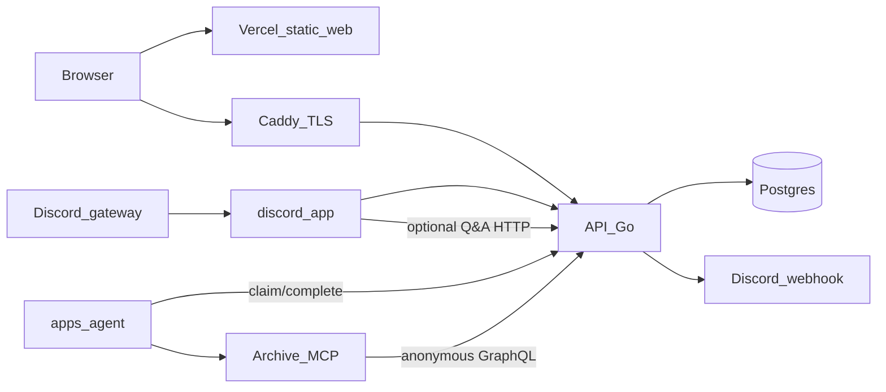

# Monorepo overview (as-built)

## Verdict

- This page is the **monorepo map**: what lives in this repository and how pieces connect.
- Product **intent**: [systems.md](/docs/systems.md) · [interfaces/](/docs/interfaces/README.md).
- CI and `scripts/verify` are the “implemented” signal.

## Applications

| App | Runtime | Role | Docs |
| --- | --- | --- | --- |
| `apps/api` | Go (GraphQL + REST) | Authoritative API, worker, persistence | [apps/api/docs/](/apps/api/docs/README.md) |
| `apps/web` | TypeScript (React, Vite) | Member-facing SPA | [apps/web/docs/](/apps/web/docs/README.md) |
| `apps/discord` | TypeScript (discord.js) | Guild activity sensor + optional mention agent | [apps/discord/docs/](/apps/discord/docs/README.md) |
| `apps/agent` | Python (uv) | Grounded Q&A worker + Archive stack | [apps/agent/docs/](/apps/agent/docs/README.md) |

## Shared contract

`packages/contracts` holds the canonical GraphQL schema and OpenAPI. Interfaces: [graphql-schema](/docs/interfaces/graphql-schema.md), [agent-qa-http](/docs/interfaces/agent-qa-http.md).

## How it moves

Authoring is website-first. The bot is a sensor; the API announces. See [discord-sensor](/docs/interfaces/discord-sensor.md). Agent Q&A: [agent-qa](/docs/systems/agent-qa.md).

## Related

- [Systems map](/docs/systems.md) · [Interfaces](/docs/interfaces/README.md) · [Requirements](/docs/requirements/README.md) · [Semantics](/docs/semantics/README.md)
- Runbooks: [deploy/docs/](/deploy/docs/README.md)
