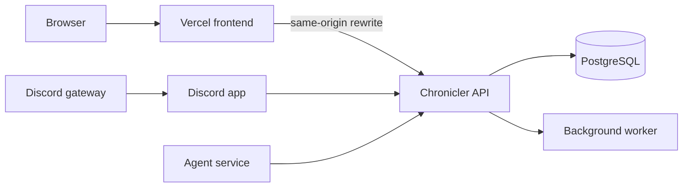

# Chronicler monorepo overview

This repository contains the Chronicler campaign-management product and its shared contracts. Product intent lives in [systems](/docs/systems.md), [interfaces](/docs/interfaces/README.md), [requirements](/docs/requirements/README.md), and [decisions](/docs/decisions/README.md). App-specific implementation notes live under each app's `docs/` directory.

## Applications

| App            | Runtime                   | Role                                               | Docs                                         |
| -------------- | ------------------------- | -------------------------------------------------- | -------------------------------------------- |
| `apps/api`     | Go                        | GraphQL and REST API, worker, persistence          | [API docs](/apps/api/docs/README.md)         |
| `apps/web`     | React and Vite            | Member-facing site                                 | [Web docs](/apps/web/docs/README.md)         |
| `apps/discord` | TypeScript and discord.js | Discord activity sensor and optional mention agent | [Discord docs](/apps/discord/docs/README.md) |
| `apps/agent`   | Python                    | Agent service and archive tools                    | [Agent docs](/apps/agent/docs/README.md)     |

`packages/contracts` contains the shared GraphQL and OpenAPI contracts.

## Request and release paths

The staging site is `chronicler.piyushsatti.com`, with API `chronicler-api.piyushsatti.com` through Cloudflare Tunnel. Production uses `chronicler.smokebombstudios.com` and API `chronicler-prod-api.piyushsatti.com`. The production API, worker and bot are targeted for one VM, published through a `cloudflared` container, with Supabase PostgreSQL ([D51](/docs/decisions/D51-Production-On-One-VM-Behind-Cloudflare-Tunnel.md)). Both release workflows exist; neither has been verified end to end.

Production changes follow the single GitHub Actions release authority in [D33](/docs/decisions/D33-GitHub-Actions-Owns-Production-Releases.md). See the [deployment runbooks](/deploy/docs/README.md) for the target and its current gaps.

## Related maps

[Systems](/docs/systems.md) · [Interfaces](/docs/interfaces/README.md) · [Requirements](/docs/requirements/README.md) · [Semantics](/docs/semantics/README.md)
