# Mortal bard feedback: history and requirements

This document keeps the requests Mortal bard (owner-tester for the Lightfall community) sent about Chronicler staging, close to verbatim, with his screenshots. It then groups them into high-level requirements to work from.

- Source: Discord DM thread with parsec (Piyush). Read-only export on 26 Oct 2026.
- Site tested: staging, `https://chronicler.piyushsatti.com`.
- Window: 25 Oct 2026 11:56Z to 26 Oct 2026 11:27Z. Messages before that (7 to 24 Oct) are unrelated chat and call logistics and are left out.
- Times are UTC. Discord showed them in UTC-4.
- `#NN` is the message's position in the export (0 = oldest, 7 Oct). It is a local reference only, not a Discord ID.
- Text is quoted as written, including spelling. Comma-joined lines in #94 come from how Discord rendered list lines; they are split back into lines here.
- External links (logo, map image) are kept as links. Nothing was downloaded from them.
- PR [piyushsatti/chronicler#14](https://github.com/piyushsatti/chronicler/pull/14) stays open until every requirement below is closed.

## Contents

1. [Transcript](#transcript)
   - [Round 3: 25 Oct](#round-3-25-oct-2026)
   - [Round 4: 26 Oct](#round-4-26-oct-2026)
2. [High-level requirements](#high-level-requirements)
3. [Older items still open](#older-items-still-open)
4. [Open owner decisions](#open-owner-decisions)

## Transcript

### Context

> **#87 parsec:** can you help me qa this with the flows and what not - https://chronicler.piyushsatti.com/

parsec later asked to finish the same day for release (#89) and said he would prepare everything (#92).

### Round 3: 25 Oct 2026

#### #94, 15:36Z: first feedback batch

> Feedback
> First of all, please make maps a separate tab
> Change the body font everywhere to Lato
> Give me the admin role so I can test the site further
> Codex
> Make sure the kanban view renders the markdown in the small view properly

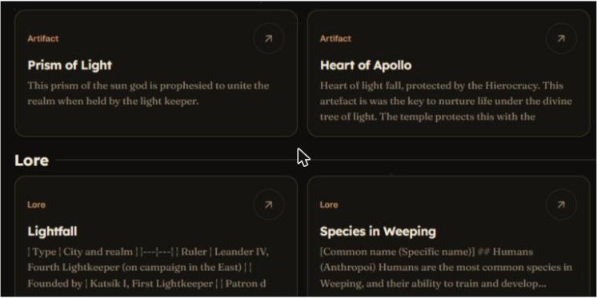

#### #95, 15:43Z: title spacing

> The title spacing is not the same between all pages, please make the spacing between the title and subtitle on the chronicles and codex page, the same as the rules page (Which is what every other page has.)

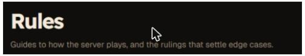

#### #96, 16:19Z: logo

> change the tab icon and nav icon to https://i.ibb.co/p6Rv4rsF/Sample-v8.webp

#### #97 and #98, 16:31Z: cause of the title shift

> I think it might be the new entry button pushing down the titles

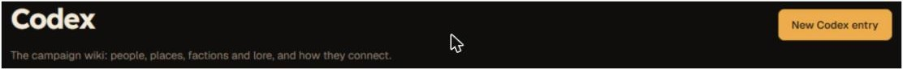

> Yeah its the new entry buttons, when I open as spectator only, all titles are properly alligned

#### #99, 16:33Z: toolbar spacing

> the toolbar of the chronicles page has different spacing for its options as compared to everywhere else

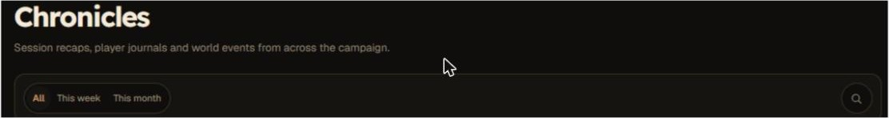

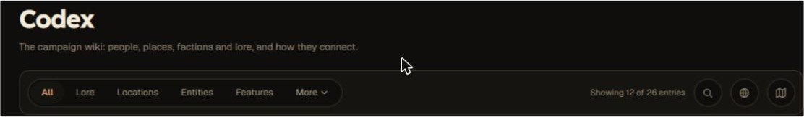

#### #100, 16:57Z: map page

Summary of a long message, with his key lines quoted:

- He needs to talk about the maps page and has "no clue what connections are."
- "pin numbers on the map view are very weird to use"
- His hex maps are flat-topped, like his files, but the view shows vertical hexes, "probably because it renders these connections".
- "When you hover over any hex, a highlighting ring follows your cursor around"
- "When you click on a hex, the ring remains around that hex, you see the hexnumber show up on the hex and then the side bar view changes to what is being shown currently"
- "Please don't bother with arrow key travesing"

His mockup (original file `DnD_Notes47.png`): hex ring on LFC1001 with the side panel.

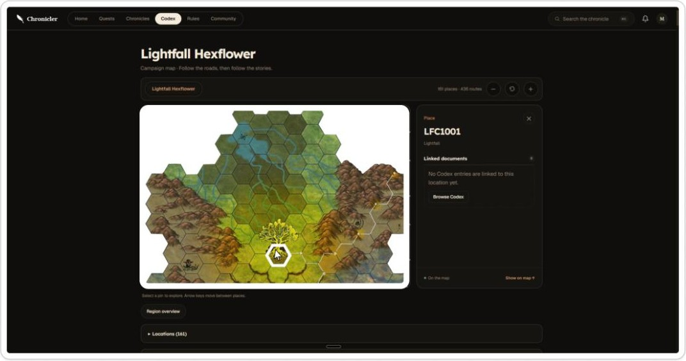

#### #101, 17:18Z: rules board

> Rules
> Make the kanban view similar to the codex with the categories/clusters separating the different guides

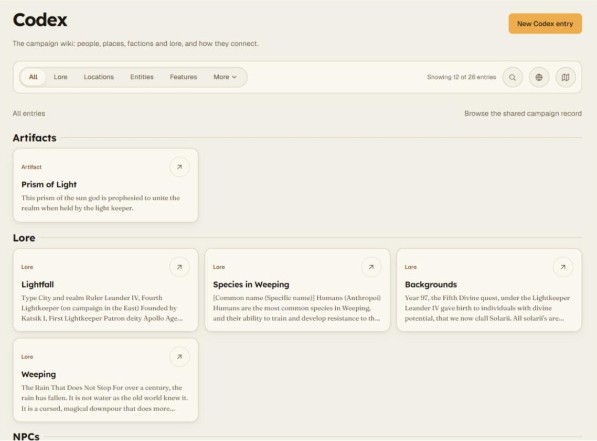

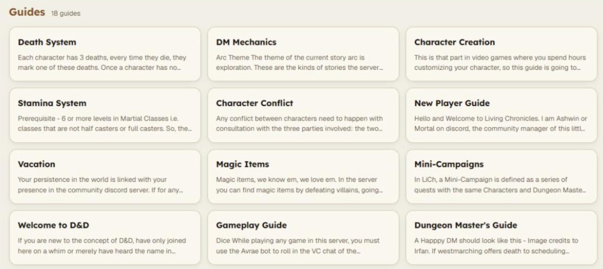

#### #102, 17:24Z: guide side box

> Remove this more guides section, or move it to the bottom of the guide, and extend the view port to the edge… The current empty space seems forces and just makes the guide's scroll length longer.

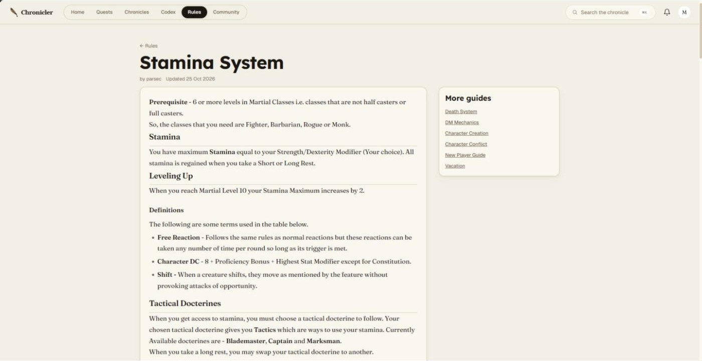

#### #103, 17:26Z: chronicle entry side boxes

> Same here in summary view, move these section's as horizontally aligned right under the title and extend the view port all the way across.

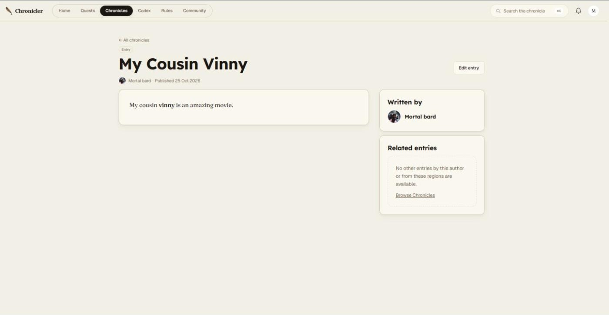

#### #104, 17:27Z: codex entry side box

> Same here in codex view. Move 'More in Artifacts' to the bottom, extend view port across.

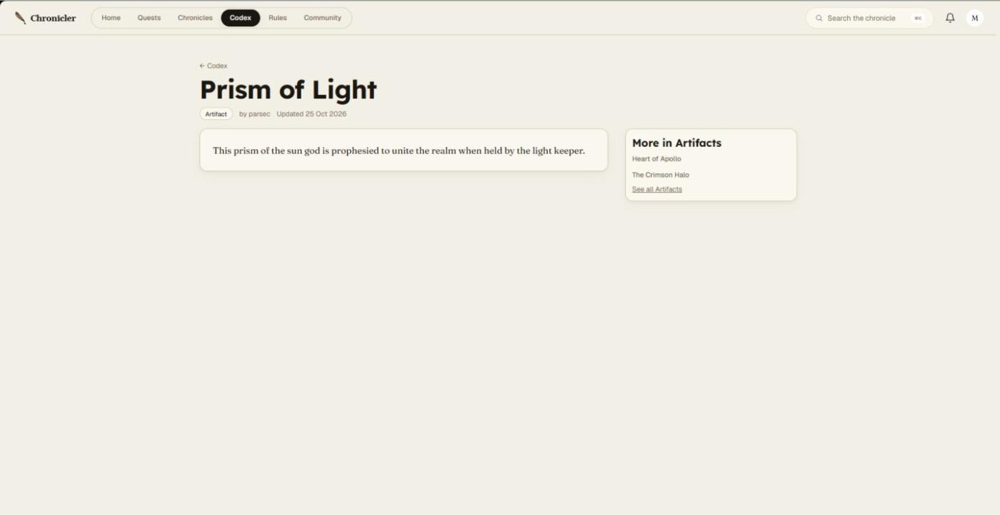

#### #105, 17:33Z: home card

> Home
> Under the recently happend section, instead of the whole shape being a button its only the link, which breaks the pattern established everywhere else in the site

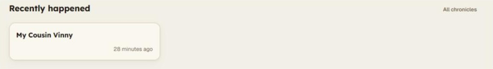

### Round 4: 26 Oct 2026

#### #106, 05:59Z: admin calendar

> calender page within admin isn't working.

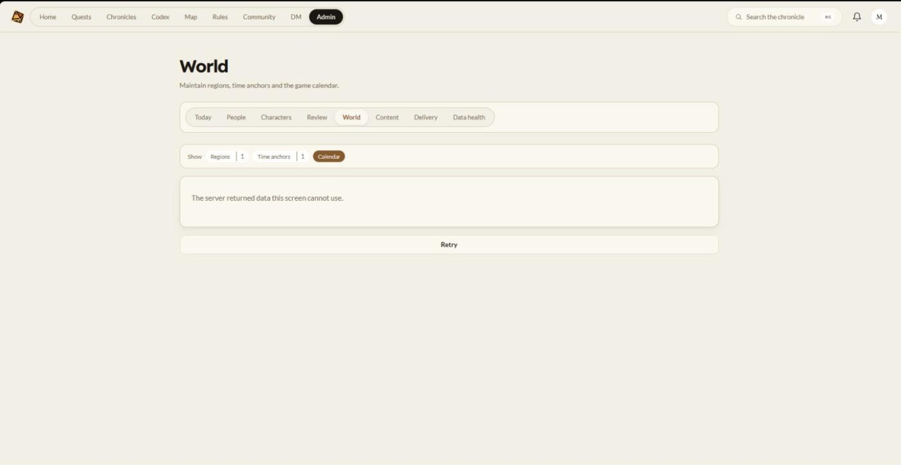

#### #107, 06:00Z: quest additional information

> these both should be within the quest creation form itself. Also for the hexpicker, make it searchable by name of hex as the current scroll length is insane.

The screenshot shows Series (with Save series) and Pointcrawl associations (per-hex Expected destination / Visited) under "Additional information" on the quest page.

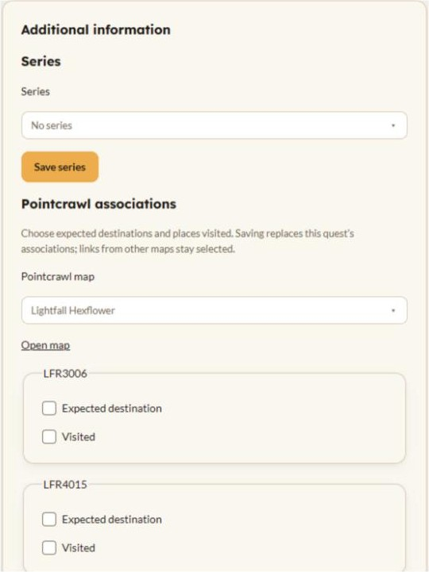

#### #108, 06:01Z: quest request

> for a player, there should also be a quest request button upon there, with the quest request form behind it.

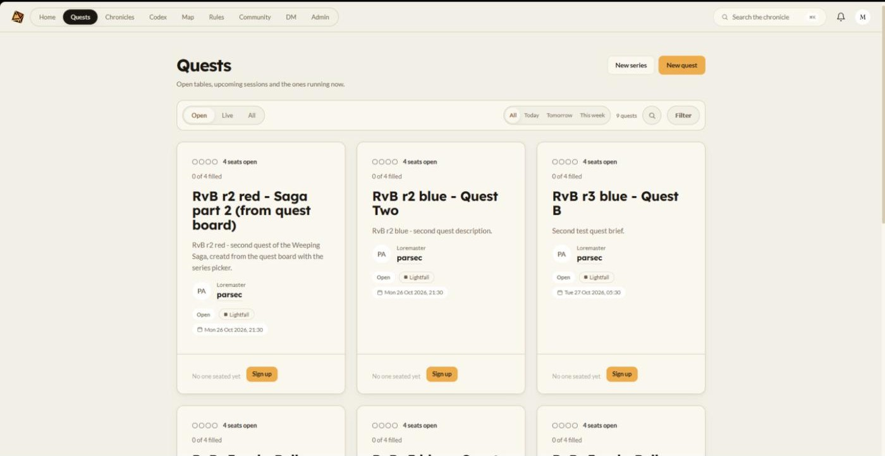

#### #109, 06:02Z

> The map function's like a dream now.

#### #110, 06:05Z: connections and locations

> all though i still don't know what connections are, and how can i add a location when all locations are hexes, is this supposed to be here for adding new hexes?

#### #111, 06:08Z: rules editing

> Under rules, I seem to have lost the capacity of adding guides to certain clusters and later editing them

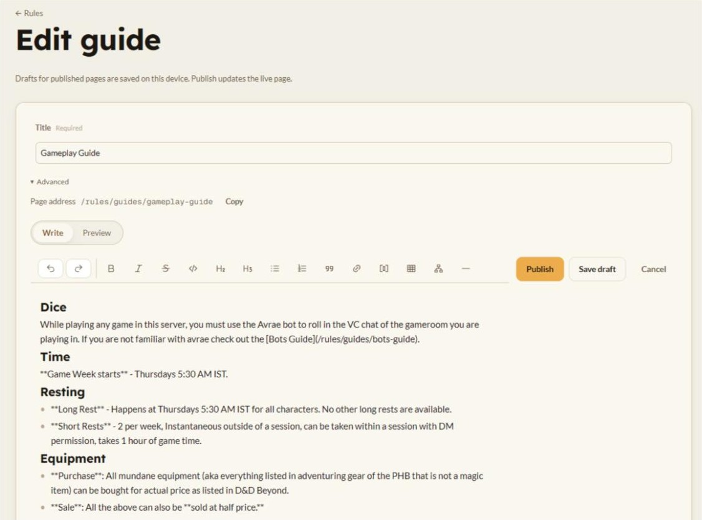

#### #112, 06:08Z: paragraph spacing

> everywhere in the markdown preview, the spaces between paragraphs are no longer being rendered.

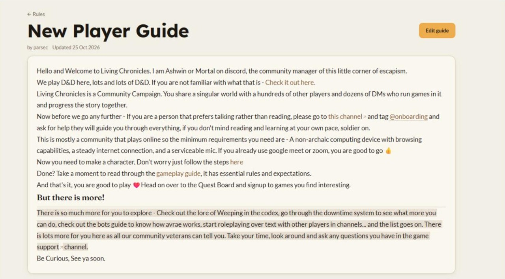

#### #113, 06:15Z: map card preview

> The preview page of the map here should be the image of the map. So it is more easily identifiable.

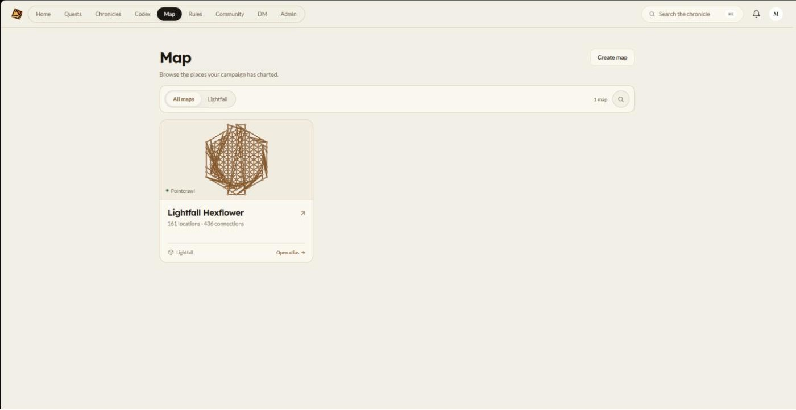

#### #114, 06:21Z: character options

> We don't need these character option picker on the page here, this info is already there on the DDB sheet. And if these are there to provide native tracking, then separate the options into class, species and backgrounds. And allow me in the admin category to edit the options within those lists.

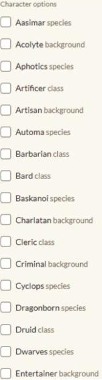

#### #115, 06:24Z: review queue

> my character is awaiting approval, yet I don't see it in the review window.

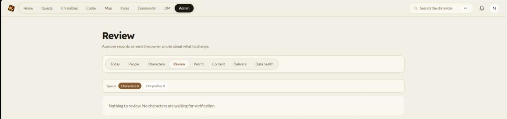

#### #116, 06:47Z: map sidebar documents

> In the side bar next to map, make the titles of the linked documents more visible. We do not need to see the codex.feature or subject tag's here, just the title and the description of each linked document will do.

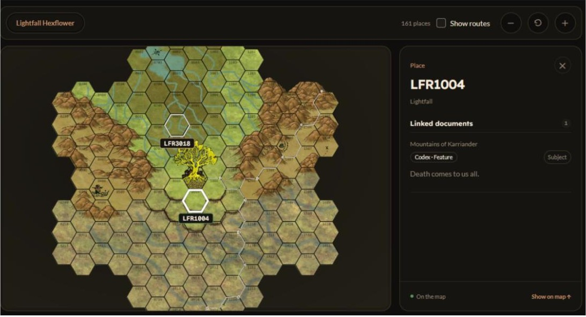

#### #117, 08:20Z: signup type

> In the quest creation form, change the signup type options to - Last Game Played and DM pick. Reminder about the last game played algo - the higher the amount of time since the last game you played, the higher up in the priority list you should be. New players should always be picked first.

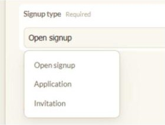

#### #118, 10:48Z: Hall of Fame

> Finally please add a hall of fame tab, where we can commend our testers, volunteers etc. It need not be anything fancy, a simple markdown page would do. But if bandwidth exists, I would like to see the capablity to create a named list on this page and be allowed to enter items in those lists. The lists don't need to be clickable so long as they are clearly visible and can adjust around more lists being added later down the line as the community grows.

His mockup (original file `DnD_Notes48.png`): boxes titled Testers, Moderators and Silver Jublee DMs, each with a bullet list.

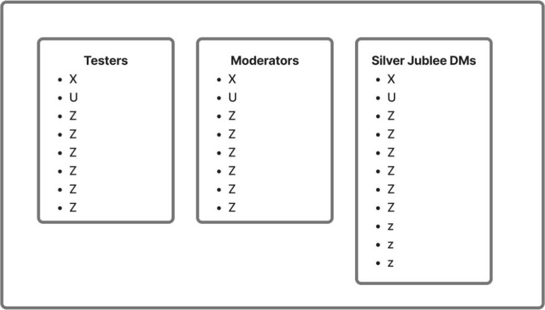

#### #119 and #120, 10:52Z: link location error

> When i try to link a location to a hex with 1 location already linked to it, I see this error, it sustains through refreshes

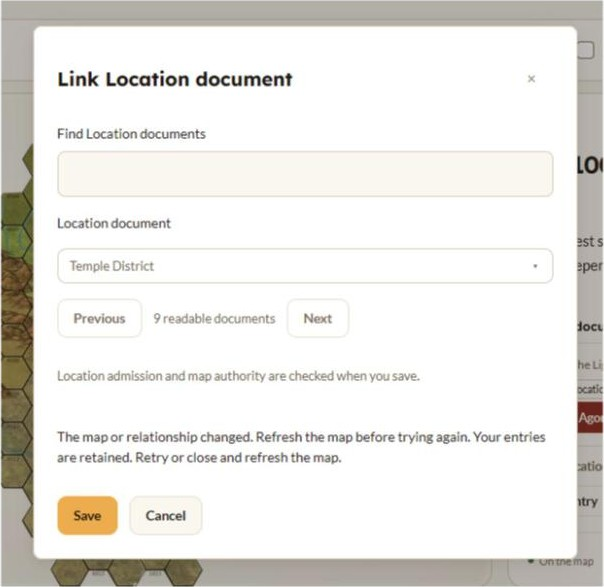

> Curiously this issue does not occur when just adding more features to a hex, only when linking locations

#### #121, 10:56Z: relinking features

> Also I can unlink features I created on a hex but I can't link them back, because for some reason article linking is limited to the location category only

#### #122, 10:59Z: new map image

> Replace the underlying image on the map with this one - https://i.ibb.co/q3W80pYX/Tree-of-light.png The current one has old hex numbers on it which are confusing.

#### #123, 11:00Z: naming

> The code might be getting confused with you calling hexes locations, just call them hexes as that is how they are refered to in all documentation, locations exist on point maps and features are things that exist within hexes.

#### #124, 11:07Z: create map

> Here in the create map section, let me actually upload a map image. Make me choose between hex map and point map. (Which btw the lightfall hexflower map should be identified as a hex map) Idk what atlas code here stands for, same for family.

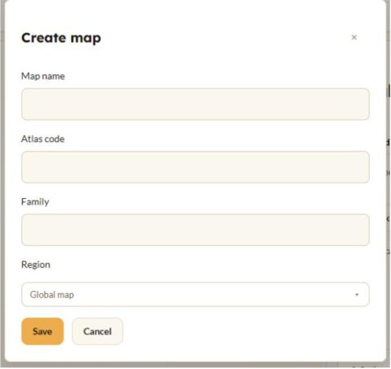

#### #125, 11:10Z: point map coordinates

> Morever, when I am adding location's in a point map, its asks for x, y, for this purpose, please show in the bottom right corner of the map view window, the current x and y locations of the cursor… Of course the ideal case solution, is If I can right click any on an empty space on the point map, and the add location pop up opens, with the xy cordinate already filled in.

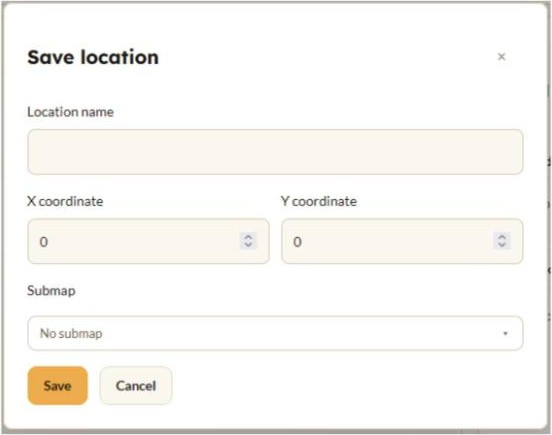

#### #126, 11:16Z: edit map

> Also while atm I can create maps, I see no options to edit maps, or map names etc, that should be a button.

#### #127, 11:18Z: spoiler tags

> Gimme a reminder of how those advanced spoiler tags work, I need to deploy them on the magic items page

#### #128, 11:21Z: free this week

> the button to mark yourself free should be on this page itself

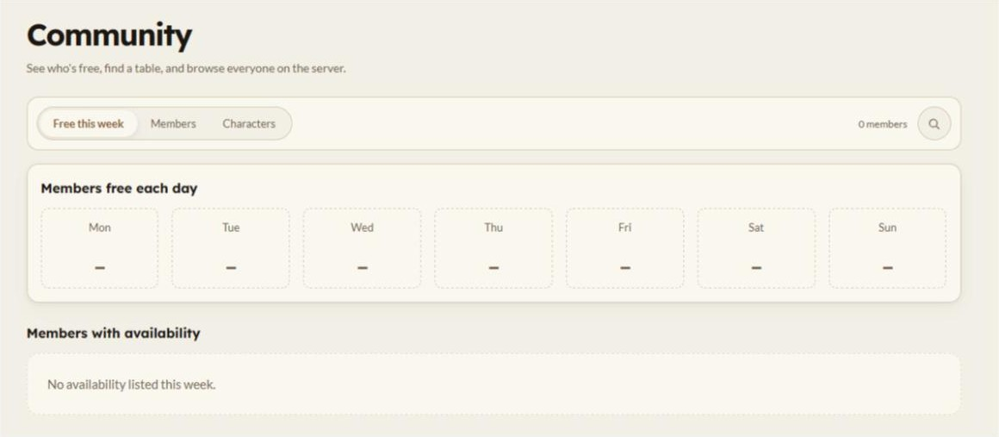

#### #129, 11:27Z: wrap-up

> Aight that should be everything, I have interacted with every single surface, the quest delivery surface also needs setup still but I assume you know of that one already.

## High-level requirements

Status key:

- **done**: shipped and checked on staging.
- **shipped, unverified**: a commit on PR 14 targets it, but nobody has checked it on staging against his screenshot.
- **open**: no work yet.
- **decide**: needs an owner answer before work starts.
- **answer**: a question, no code.

IDs are stable. Do not renumber; add new IDs at the end of an area.

### Navigation, brand and type (NB)

| ID | Requirement | Source | Status |
|----|-------------|--------|--------|
| NB-1 | Maps is its own top-level tab, titled "Map". | #94 | shipped, unverified (6e401ac sets page title "Map") |
| NB-2 | Reading text uses Lato everywhere; headings keep their fonts. | #94 | shipped, unverified (6e401ac) |
| NB-3 | Favicon and nav icon use the new logo. | #96 | shipped, unverified (6e401ac adds `apps/web/public/brand/chronicler-logo.webp`) |
| NB-4 | Owner-tester has the admin role on staging. | #94 | done (per earlier plan notes) |

### Page layout (PL)

| ID | Requirement | Source | Status |
|----|-------------|--------|--------|
| PL-1 | Page header actions (New entry) never push the title down; title-to-subtitle spacing matches Rules on every page. | #95, #97, #98 | shipped, unverified (6e401ac) |
| PL-2 | Chronicles toolbar option spacing matches Codex and Rules. | #99 | shipped, unverified (6e401ac) |
| PL-3 | Guide, chronicle and codex entry pages use full width. Related boxes (More guides, More in Artifacts) move below the body. Chronicle byline and related items sit in one row under the title. | #102, #103, #104 | shipped, unverified (6e401ac) |
| PL-4 | Home "Recently happened" card is one link, like cards elsewhere. | #105 | shipped, unverified (6e401ac) |

### Markdown and cards (MD)

| ID | Requirement | Source | Status |
|----|-------------|--------|--------|
| MD-1 | Board card excerpts show clean text, not raw markdown. | #94 | shipped, unverified (6e401ac strips markdown in excerpts) |
| MD-2 | Markdown preview keeps blank space between paragraphs everywhere. | #112 | open |
| MD-3 | Explain advanced spoiler tags for the magic items page. | #127 | answer |

### Rules (RU)

| ID | Requirement | Source | Status |
|----|-------------|--------|--------|
| RU-1 | Rules board groups guides by category like Codex. | #101 | shipped, unverified (6e401ac) |
| RU-2 | Restore adding a guide to a chosen cluster and editing it later. | #111 | open (may be a regression from RU-1) |

### Map (MP)

| ID | Requirement | Source | Status |
|----|-------------|--------|--------|
| MP-1 | Hex interaction: hover ring follows the cursor; click keeps the ring, shows the hex code and opens the side panel; flat-top hexes; no arrow-key traversal; pin numbers not shown by default. | #100 | shipped, unverified (6e401ac). He wrote "The map function's like a dream now" (#109) after it. |
| MP-2 | Terms: hexes are "hexes" on hex maps; "locations" exist only on point maps; "features" are things inside hexes. UI copy and code paths follow this. | #110, #123 | open |
| MP-3 | "Connections" either get a clear purpose and name or leave the UI. | #100, #110 | decide |
| MP-4 | Map list card shows the map image, not a graph thumbnail. | #113 | open |
| MP-5 | Side panel linked documents: title more visible; show title and description only; no `codex.feature` or subject tags. | #116 | open |
| MP-6 | Linking a second document to a hex that already has one must work. Today it fails with "The map or relationship changed. Refresh the map before trying again." and keeps failing after refresh. Adding features works. | #119, #120 | open (bug) |
| MP-7 | A feature unlinked from a hex can be linked back. The web link dialog only lists Location documents (`apps/web/src/features/map/components/MapEditDialog.tsx:43`, `:191`). Whether the API also refuses other categories is not checked yet. | #121 | open (bug) |
| MP-8 | Replace the Lightfall Hexflower base image with `https://i.ibb.co/q3W80pYX/Tree-of-light.png`. | #122 | decide (needs OK to download) |
| MP-9 | Create map: upload a map image; choose hex map or point map (Lightfall Hexflower is a hex map); rename or explain "Atlas code" and "Family" (`apps/web/src/features/map/components/MapEditDialog.tsx:63`). | #124 | open |
| MP-10 | Edit map button: name and other fields. | #126 | open |
| MP-11 | Point maps: cursor x,y readout in the bottom-right of the view. Stretch: right-click on an empty spot opens Add location with x,y filled in. | #125 | open |

### Quests (QU)

| ID | Requirement | Source | Status |
|----|-------------|--------|--------|
| QU-1 | Series and Pointcrawl associations move into the quest creation form. | #107 | open |
| QU-2 | Hex picker in the quest form is searchable by hex name. | #107 | open |
| QU-3 | Players see a "Request quest" button on the Quests page that opens the quest request form. | #108 | open |
| QU-4 | Signup type options become "Last Game Played" and "DM pick" (replacing Open signup, Application, Invitation in `apps/web/src/utils/questVocabulary.ts:13`). Last Game Played ranks players by time since their last game, longest first; new players always first. | #117 | decide (algorithm details) |
| QU-5 | Quest delivery surface is set up. | #129 | decide (6 open questions from the quest-announce work) |

### Characters and review (CH)

| ID | Requirement | Source | Status |
|----|-------------|--------|--------|
| CH-1 | Character option pickers: remove (DDB sheet has the data), or split into class, species and background with admin-editable lists. | #114 | decide |
| CH-2 | A character awaiting approval appears in Admin › Review. | #115 | open (bug) |

### Admin (AD)

| ID | Requirement | Source | Status |
|----|-------------|--------|--------|
| AD-1 | Admin › World › Calendar loads. Today it shows "The server returned data this screen cannot use." | #106 | open (bug) |

### Community (CO)

| ID | Requirement | Source | Status |
|----|-------------|--------|--------|
| CO-1 | The "mark yourself free" button sits on Community › Free this week. | #128 | open |
| CO-2 | Hall of Fame tab. Minimum: one markdown page. Stretch: named lists (Testers, Moderators, …) with plain items, not clickable, laid out to grow as lists are added. | #118 | decide (scope) |

## Older items still open

These come from the requirements set in [`docs/requirements`](../../README.md) and were open before this round:

- R14: partial.
- R15: rename "Kingdom of Sunddi" to "The Continent of Weeping". Where the string lives is not found yet.
- R17: onboarding nav and editor.
- R18: partial.
- R-D3: hex state.
- R-D4: weekly AI job.

## Open owner decisions

1. QU-4: details of the Last Game Played algorithm (tie-breaks; what counts as "new player"; how DM pick mixes with it).
2. QU-5: the 6 quest delivery questions.
3. MP-8: OK to download Tree-of-light.png into the repo.
4. MP-3: what "connections" become (rename, explain or remove).
5. CH-1: remove character pickers, or split and make them admin-editable.
6. CO-2: Hall of Fame minimum or stretch scope.
